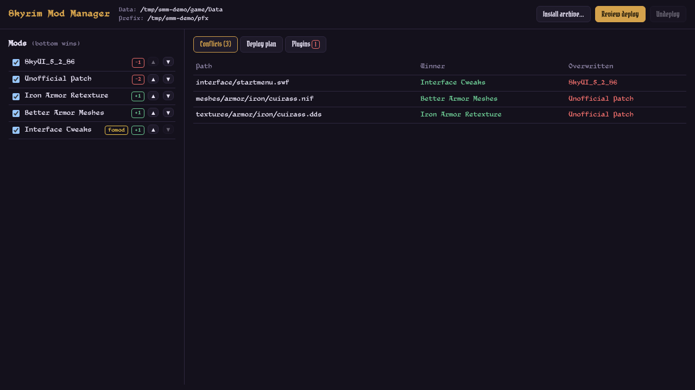

# Skyrim Mod Manager

A native Linux mod manager for **Skyrim Special Edition / Anniversary Edition under Proton**.
Conflict-first and Proton-aware: you see which mod wins every file and what a deploy will
change *before* anything touches your game folder.



> **Status: early MVP (0.1).** Back up your game before deploying into a real install.

## What works

- **Detection (read-only):** finds Skyrim SE via Steam `libraryfolders.vdf` (native,
  `~/.steam`, and Flatpak Steam), its Proton prefix (`compatdata/489830/pfx`), or a
  [umu-launcher](https://github.com/Open-Wine-Components/umu-launcher) prefix under `~/Games/umu`.
- **Install:** 7z / zip / rar (via libarchive) or a plain folder into a managed staging
  folder. Wrapper folders and `Data/` roots are unwrapped automatically. FOMOD installers
  are detected and flagged but **not run yet**; files are installed as-is.
- **Enable / disable / reorder** mods. Later mods win.
- **Conflict table:** for every path provided by more than one mod, the winner and the
  overwritten mods. Paths are compared case-insensitively, the way the game sees them.
- **Dry-run diff:** added / removed / changed files, plus any original game files that a
  deploy would replace.
- **Hardlink deploy, clean undeploy:**
  - a manifest is written *before* the first change, so even an interrupted deploy can be undone;
  - game files that would be overwritten are moved to a backup folder and restored on undeploy;
  - undeploy only removes files that are still exactly what was deployed (same inode).
    Anything you or a tool changed is left in place and reported;
  - existing folder casing in `Data/` is reused (`Textures/` vs `textures/`);
  - only folders the deploy created are removed, and only when empty;
  - falls back to copying if staging and the game are on different filesystems.
- **Plugins:** reads masters and ESM/ESL flags with [`esplugin`](https://crates.io/crates/esplugin),
  builds a load order, flags missing masters, inactive masters, masters loading after
  their dependents, and non-masters loading before masters. "Fix order" reorders with
  minimal changes. Writes `Plugins.txt` with `*` active markers (the original file is
  kept once as `Plugins.txt.smm-bak`).

## Not yet

FOMOD installer UI, BSA/BA2 content conflicts, LOOT sorting, launching through Proton/umu,
multiple profiles, and packaged releases.

## Build

Requirements: Rust (stable), Node 20+, `libarchive`, and the
[Tauri 2 Linux prerequisites](https://v2.tauri.app/start/prerequisites/#linux) (webkit2gtk 4.1).

```sh
npm --prefix ui ci
npm --prefix ui run build
cargo build --release            # builds the CLI (smm) and the desktop app
cargo test --workspace
```

Desktop app in dev mode: `npm --prefix ui run dev` in one terminal, then
`cargo run -p skyrim-mod-manager`.

## CLI

```sh
smm detect                              # where is the game / prefix?
smm install ~/Downloads/SkyUI_5_2_SE.7z
smm list
smm conflicts
smm plan                                # dry run
smm deploy --yes
smm plugins --fix --write               # fix order, write Plugins.txt into the prefix
smm undeploy
```

Global options: `--instance <dir>` (staging folder, default
`~/.local/share/skyrim-mod-manager/default`), `--data <Data dir>`, `--json`.

### Try it without touching your game

```sh
scripts/make-demo.py /tmp/smm-demo
export SMM_GAME_DIR=/tmp/smm-demo/game SMM_PREFIX=/tmp/smm-demo/pfx SMM_INSTANCE=/tmp/smm-demo/instance
for z in /tmp/smm-demo/*.zip; do smm install "$z"; done
smm conflicts && smm plan && smm plugins
```

`SMM_GAME_DIR` / `SMM_PREFIX` override detection for both the CLI and the app.

## Layout

| Path | What |
| --- | --- |
| `crates/smm-core` | library: detection, staging, conflicts, deploy, plugins |
| `crates/smm-cli` | `smm` command-line tool |
| `src-tauri` | Tauri 2 desktop shell |
| `ui` | Svelte 5 frontend |

## License

MIT, see [LICENSE](LICENSE).
